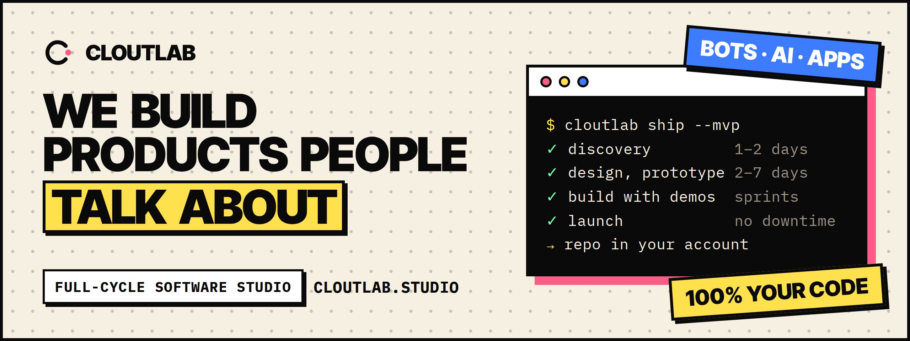
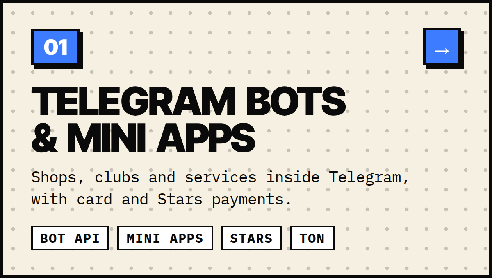
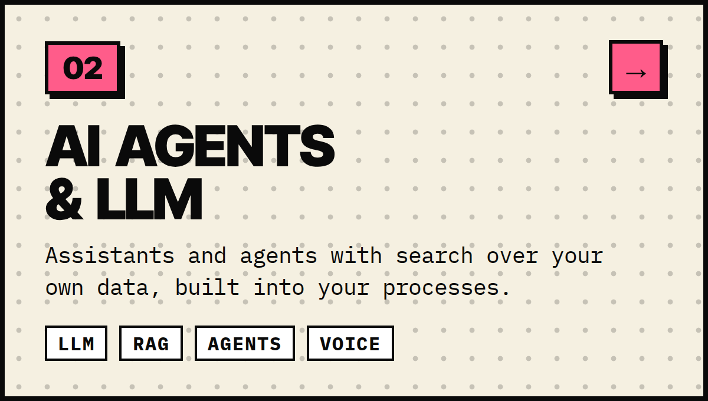
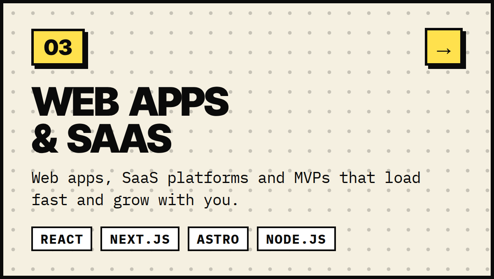
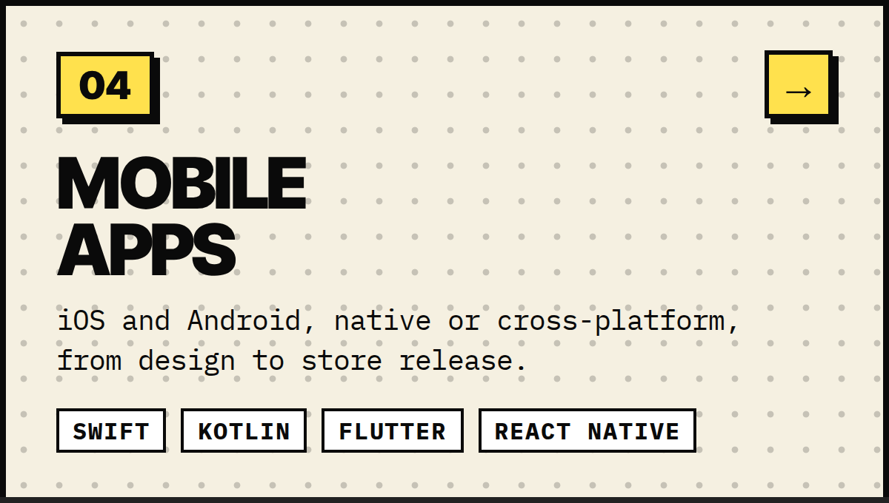
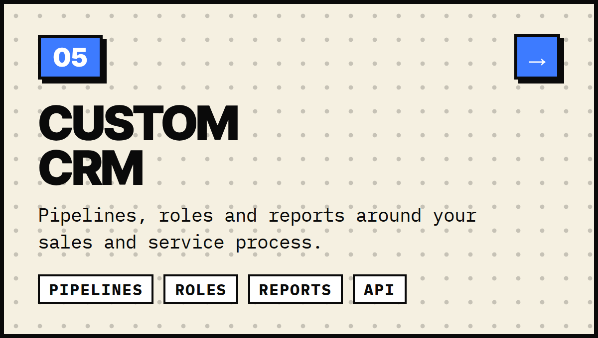
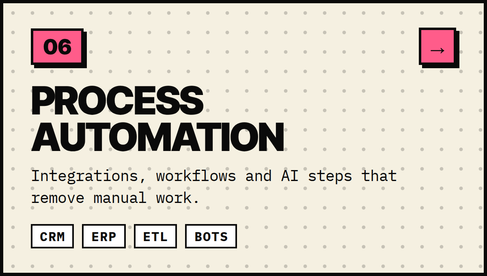
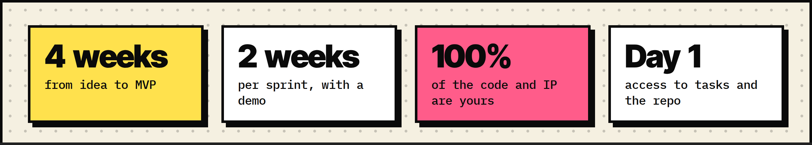
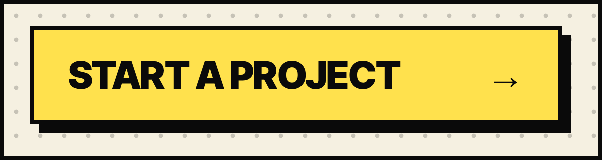
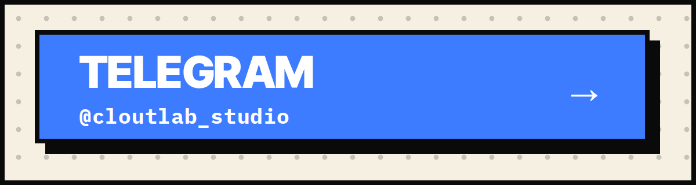

  

  <a href="https://cloutlab.studio/en/"><b>Website</b></a> ·
  <a href="https://cloutlab.studio/en/contacts/"><b>Start a project</b></a> ·
  <a href="https://t.me/cloutlab_studio">Telegram</a> ·
  <a href="https://t.me/cloutlabstudio">Channel</a> ·
  <a href="https://www.instagram.com/cloutlab.studio/">Instagram</a>

Cloutlab is a full-cycle software studio. We design, build, launch and support Telegram bots and Mini Apps, AI agents, web and mobile apps, CRM systems and automation. Creators and influencers are our flagship niche. We also work with fintech, healthcare, e-commerce, edtech, real estate, logistics and SaaS.

### What we build

  
  

  
  

  
  

### How we work

  

Exclusive rights to the code and design transfer under the contract, and the repository lives in your account. After launch we keep the infrastructure, CI/CD and monitoring running and support the product.

### Stack

`TypeScript` `React` `Next.js` `Astro` `Node.js` `Swift` `Kotlin` `Flutter` `React Native` `PostgreSQL` `ClickHouse` `Docker` `Kubernetes` `Telegram Bot API` `TON` `LLM` `RAG`

 

  
  

<b>По-русски</b>

 

Cloutlab: студия разработки полного цикла. Делаем Telegram-ботов и Mini Apps, AI-интеграции, веб и мобильные приложения, CRM и автоматизацию, от идеи до запуска и роста. Главная ниша: продукты для блогеров. Также работаем с финтехом, медициной, e-commerce, онлайн-школами, недвижимостью, логистикой и SaaS.

- **4 недели** от идеи до MVP.
- **Двухнедельные спринты** с демо результата, доступ к задачам и репозиторию с первого дня.
- **100% кода и прав ваши.** Исключительные права передаём по договору, репозиторий находится в вашем аккаунте.

[Обсудить проект](https://cloutlab.studio/contacts/) · [Сайт](https://cloutlab.studio/) · [Telegram](https://t.me/cloutlab_studio)

